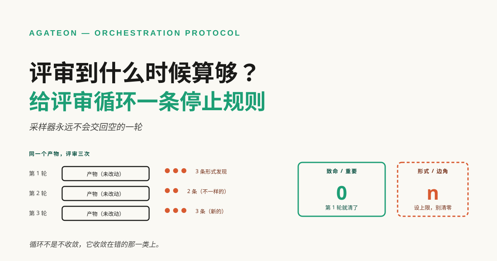
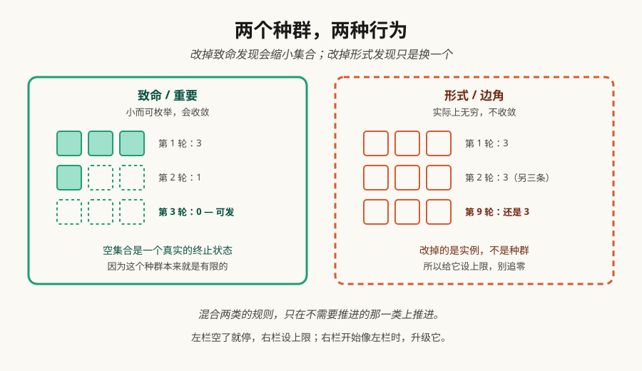

# 评审到什么时候算够？——给 LLM 评审循环一条停止规则

如果你把工作交给 LLM 评审，你大概撞过这个场景：第一轮挑出真问题，你改掉；第二轮又挑出一些，你再改；第三轮还能挑出来——一个都没说错，而这个循环永远不说"干净了"。于是问题从"这活儿做好了吗"变成"我们付几轮的钱"，多数团队用一个继承来的数字回答它——两轮、三轮——然后把最后一轮说的话当成裁决。

**TL;DR** —— LLM 评审员是采样器，不是校验器：对同一个没改过的产物跑两遍，你通常会拿到两组不同的发现，因为每次跑采样的是"它能注意到的东西"的不同切片。这让"改到没有新东西出现"成为一个没有终止保证的判据——通常总还有下一次采样。解法不是换个更好的提示词、也不是把轮次上限调高，而是别再数轮次、开始给发现分类。致命与重要的发现构成一个小而可枚举的集合：这个集合空了，你就可以发。形式上的小发现实际上是无穷的、每轮还不一样：给它们设上限，别想着清零。下面讲两类发现为什么行为不同、一条你能写进自己流程的停止规则，以及我们自己的评审记录作为一个算例——包括那一轮剩下的全都已经是我们决定不拦的东西。

## 是采样器，不是校验器

测试跑完是个校验器：同一份代码，它永远给同一个裁决。这种可复现性才让"测试全绿"能当门用。

LLM 评审员没有这个性质。把同一份产物给它两遍，你通常会拿到不同的发现：这一遍它注意到一处过时的交叉引用，另一遍它注意到一个缺失的定义，而两遍都没说错。发现是真的，只是集合不稳定。由此有两条推论，而这两条都在悄悄支撑你该怎么跑这个循环。

**第一，"没有新东西"没有终止保证。** 任何声称"一直评审到某一轮空手而归"的流程，描述的是一个采样过程，却在要求它停止采样。产物足够大时，你通常会得到一轮又采样到点什么的结果；某一轮确实可能空手而归（小产物上尤其如此），但那是一轮碰巧什么都没采样到——这是另一个论断，而且弱得多。

**第二，轮次是错的变量。** 轮次是"还剩多少风险"的一个代理，而这个代理两个方向都不准。三轮可能绕过一个致命缺陷，只要每一轮都刚好从它旁边采样。小产物、窄风险面，一轮也可能够了。

这不是反对 LLM 评审。采样恰恰是它管用的原因：一个全新的上下文能注意到作者的上下文盲掉的东西。要点是——**采样器需要跟校验器不一样的停止规则**。

## 两类发现，只有一类会收敛

仔细看一轮评审回来的东西，它会分成两个行为完全不同的种群。

| | 致命 / 重要 | 形式 / 边角 |
|---|---|---|
| **集合大小** | 小且可枚举 | 实际上无穷 |
| **意味着什么** | 产物是错的或用不了 | 产物没问题，只是能读得更顺 |
| **再跑一轮有用吗** | 有——你买的就是这个 | 基本没用——你拿到的是另一个样本，不是更干净的产物 |
| **停止判据** | 集合为空 | 数量在阈值之下 |
| **例子** | 引用的某个说法是假的、链接 404、一节与另一节自相矛盾、引用了图但正文里没插 | 一个词用了两遍、标题能更紧、标签顺序不同、图注写"五条"而图上其实三条 |

要命的不对称在这里：**改掉一个致命发现，是把它从种群中移除**；改掉一个形式发现，也移除了那一个实例，但种群大到下一次采样会捞出它的邻居。这就是为什么混合两类发现的循环永远不终止、却在看起来一直在推进——而且它确实在推进，推的是不需要推进的那一类。

所以规则不是"少评审"，是"别再对两类发现问同一个问题"。

## 一条你能写下来的停止规则

四条，且没有一条提到轮次：

1. **拦：任何致命发现。** 致命 = 产物是错的或用不了的——一个假说法、一条读者会走的坏路径、一个全篇依赖却缺失的部分。这个集合可枚举，所以"零"是个有意义的目标。
2. **拦：任何重要发现。** 重要 = 读者会被误导，或者得自己花力气才能恢复——一个没给分母的数字、一个没说明且会改变结论的假设、一个证据在另一个仓库的说法。
3. **不拦形式发现；给它们设上限。** 选一个你愿意每轮修掉的数字（我们用的是"便宜的那些"，实操上就是一小把），剩下的全是形式发现时就停。把上限写下来，免得下一轮重新吵一遍。
4. **写一条升级条款。** 一个形式发现，如果累积到开始影响可信度，就变成重要发现。一个错别字是形式问题；一篇讲数字纪律的文档里错了十二个数字就不是——到某个点读者会不再相信剩下的部分，那是一个穿着形式外衣的致命失败。

这条条款比看起来重要。没有它，"形式"就成了什么不方便就扔进去的地方，规则退化成"作者想发什么就发什么"。有了它，规则有一个你可以**事先**争论的失效方式。

还有一条方向是升级条款覆盖不到的，而且是最危险的那条：一个重要发现被误归为形式发现，就会静默通过，因为下游不会再有人问起它。便宜的护栏是：把每个产物里"你选择不拦"的那些发现记下来。一份必须写下来的清单，比较难被塞满你宁愿忘掉的东西。

## 我们的记录显示了什么

每一轮发现了什么我都记着，因为有一篇走到第三轮时，我已经记不清哪些发现拦过我、哪些只是我容忍了。下面两个例子就出自这份记录（它作为[发布清单](https://github.com/randomgitsrc/agateon/blob/main/site/guides/publish-checklist.md)存在仓库里，每发布一篇记一条）。两个例子，都来自评审每一次都说对了的稿子。

**一篇走的是 FAIL → FAIL → PASS。** 第一轮发现三件事——正文引用了插图但从来没插进去（读者会看不到图）、一个句子超出了我们自己的行文预算、一个术语在被定义之前就用了。第二轮发现单句里还剩一处对称问题。第三轮通过。

第一轮才是值得看的那一轮。三个发现、三种不同的严重度：一个会产出肉眼可见的坏页面，一个是风格配额，一个是理解问题。三条都长着同一个词——FAIL——因为评审没有渠道去说"这条拦、那两条是口味"。

**另一篇走的是 FAIL（五条必改）→ FAIL（四条，全是新引入的）→ PASS。** 第二轮值得停一下：那四条是**被第一轮的修复引入的**。评审不是在挖更深的问题，它是在找上一轮修补造成的破坏。一个轮次上限会放过它们，因为第二轮是"修复轮"。

这两条序列都没有说评审判太严。它们说的是：评审只有一条输出通道，却要装两种东西，而我们在读通道，不在读内容。

### 评审对自己也是采样器，这部分最扎人

最锋利的证据不在博客里。它来自一份[内部评估文档](https://github.com/randomgitsrc/agateon/blob/main/docs/research/agateon-value-assessment-20260929.md)，我们把同一套循环用在它身上，走到了第三版。第一版含十处错误、由评审报出——而文档自己写明这是"已报告的子集"而非全部，所以错误率不可计算。第二版改掉了它们，又引入了新的。第三版又发现三处——其中包括，说来讽刺，它对自己哪些说法是机器可核的、哪些不是，标错了一处。

**一份讲验证纪律的文档，在自己的元数据里犯了一个验证错误。** 这就是采样器性质最纯粹的形态：同一个作者、同一套标准、第三遍，新的一类漏网。没有任何轮次预算能预测它，也没有任何轮次预算能拦住它。

## 这条规则不解决什么

**它不保证类别是客观的。** "致命"和"形式"是判断，两个讲道理的工程师会在边界上意见不合。规则不消除那个判断，它只是逼这个判断发生一次、并且明说，而不是每一轮由拿着 FAIL 的那个人重新吵一遍。

**它不保证致命发现在实践中可枚举。** 原则上可枚举。实践上，你会在某个未来的产物上发现一类新的致命发现，而规则当时没有这个槽位。这没关系——只要你是加一个槽位，而不是把它塞进"形式"。

**它不迁移数字。** 我们的评审员、我们的产物大小、我们的容忍度——这些没有一样是你的配置。可迁移的是规则和形状，不是里面的数值。

**它也没说评审便宜。** 规则让成本变得可预测，不是变小。如果你的致命集合已经空了、你还在继续评审，那你是按全价在买形式发现的样本。

## 下一次评审循环就这么做

1. **第一轮之前，把两张表写下来。** 什么会让这个产物是错的或用不了的？什么只是口味？第一张表填不满，说明你还不清楚自己在交付什么。
2. **让评审员给每条发现打标签。** 不是打分，是分类。评审员分不了，就在分诊时分类一次。
3. **第一张表空了就停。** 不是发现没了，是**拦人的**发现没了。
4. **把形式发现的上限写下来**，升级条款写在它旁边。
5. **每轮把分类记下来。** 那份记录是几篇之后告诉你"你的致命清单是否完整"的唯一途径——也是这条规则自我改进的唯一途径。

这条规则不是让你发得更快的办法。它是让你知道自己在发什么的办法——而那个东西，正是那个永不终止的循环一直在替你藏起来的。
