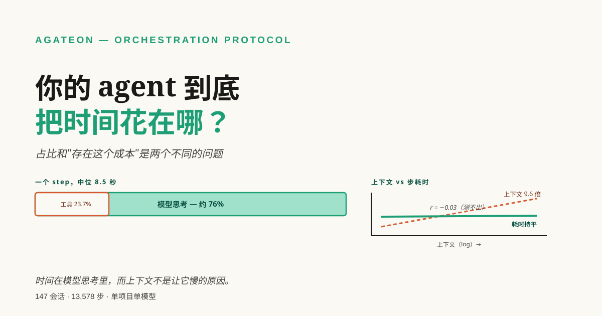
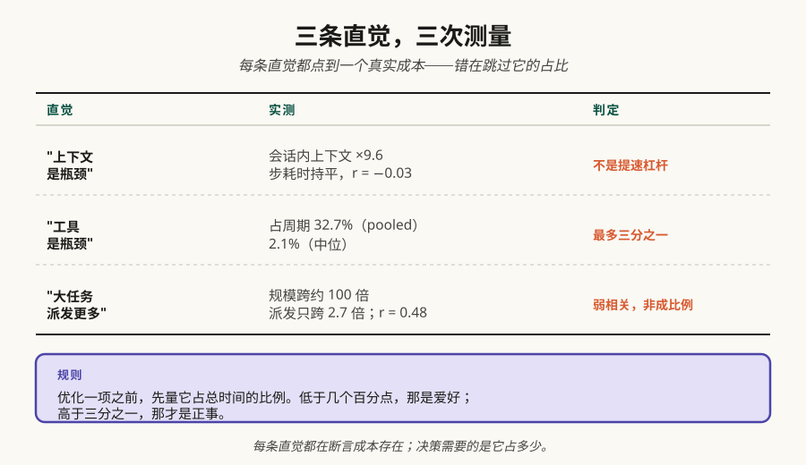

# 你的 agent 到底把时间花在哪？

当一次 agent 会话感觉慢，最先想到的解释有三个：上下文太长了、工具太慢、任务太大了——每个都带着一个显而易见的修法：压缩上下文、加速工具、拆分任务。

我们有机会把这三个都拿到真实会话日志上对一遍：147 个会话、13,578 步、一个项目，全部来自运行时自己的事件流。三条解释里两条没通过测量，第三条比看起来弱得多。



**TL;DR** —— 先量再优化，因为最像样的三个成本解释大多是错的。在我们的日志里：上下文在一次会话中涨了 9.6 倍，而每步耗时是平的（与 log 上下文的相关性 -0.03，等于测不出关系）；工具往返占总 step 时间约三分之一，但中位 step 只有约 2%；派发次数与代码规模只是弱相关（100 倍规模跨度上 r = 0.48）。下面给出这三项在你自己运行时上怎么算、为什么第一条最反直觉，以及一条决策规则：**先估出这一项占总时间的比例，再决定要不要优化它。**低于几个百分点，那是爱好；高于三分之一，那才是正事。

## 日志里有什么

一个会记录自身事件流的 agent 运行时，能让你不做任何额外埋点就拿到每步的三个时间点：

- `step/start`：模型开始思考之前；
- `assistant/message`：模型这一轮结束；
- step 内部的 `tool/call` 与 `tool/result` 配对：模型要东西、东西回来。

从这些能算出：step 耗时（本次 start 到下一次 start）、其中工具往返占多少、以及每一步模型看到的上下文有多大——多数运行时会把 token 数挂在 assistant message 上。

有一条限制贯穿全文：这里的数字来自**一个项目、一个模型、一台机器**。它们足够说明"那三条直觉不能当默认值"，但不足以替代你自己的数字。所以才要给出配方。

## 直觉一：上下文是瓶颈

这是三条里最直觉的。上下文长意味着要 attend 的 token 多，每一步就该更贵。压缩、摘要、"上下文卫生"都是从这条推出来的。

测量不支持它。在 123 个长到能比较的会话里，会话结束时上下文的中位数是开始时的 **9.6 倍**。如果长度决定延迟，每步耗时应该稳步上升。它没有：

| 我们测量的 | 结果 |
|---|---|
| 步数足够比较的会话 | 123 |
| 上下文增长中位（首步→末步） | **9.6x** |
| log₁₀(上下文) 与步耗时的相关 | **-0.03** |
| 步耗时中位 | 8.5 秒 |

-0.05 不是"上下文让它变快"。这是**什么都测不出来**时会出现的值。同一批日志早些时候用另一种算法算，给的是 **+0.085**——同样与零无法区分，符号相反。那不是抽样噪声：换五种样本定义重算，值每次都还是负的。正数来自不同的配对与统计量，而这恰好就是这篇要讲的那个陷阱。

**同一批日志的两次计算互相矛盾，这才是发现。** 当两种都站得住脚的算法在符号上不一致时，两个符号都不值得引用。站得住的表述只有：在这个样本里，每步耗时不由上下文长度解释。

那由什么解释？数据指向任务而不是文本量：耗时与"这一步发生在会话的第几步"相关得多（同样本内 r ≈ 0.6）——也就是与"此刻模型被要求做什么"相关，而不是与"它手上握着多少字"相关。

**实际后果。** 压缩能给你对付硬性上下文上限的余量，它买不来速度——除非你的运行时有一种我们样本里没有表现出的特定病理。如果你的会话撞上限然后死掉，去压缩，那是修正确性；如果会话只是慢，压缩是错的杠杆，而不测量你就不会发现这一点。

## 直觉二：工具是瓶颈

这条对 agent 负载感觉显然为真：agent 要跑命令，命令要花时间，所以开销在命令上。

按正确的口径量，工具往返约占**总** step 时间的三分之一——但只占典型一步的约百分之二，因为极少数重周期扛走了几乎全部：

| 我们测量的 | 结果 |
|---|---|
| 分析的 step 周期 | 13,281 |
| 周期耗时中位 | 8.8 秒 |
| 工具往返占**总** step 时间 | **32.7%** |
| 工具往返占**中位** step | **2.1%** |
| 前 10% 周期贡献的工具时间占比 | **96%** |

32.7% 与 2.1% 之间的这个差，就是这一节的重点，而且它不是定义上的抠字眼——它是"求和"与"典型值"的区别。

当你把所有工具往返加起来、再除以所有 step 的总和，少数重工具周期会主导分子。在我们的日志里，**前 10% 的周期贡献了 94% 的工具时间**。中位 step 花在工具上的时间约百分之二；按总量加权的数字说接近三分之一。这两个都是同一份数据的真实陈述，却支持相反的决策。

**第一个数有多敏感？** 比我们预想的敏感得多，而这一点值得摆出来而不是藏起来。同一批日志，取决于你怎么处理长 step，pooled 会给出 **1.5%**、**32.7%** 或 **23.7%**：

| 过滤方式 | pooled | 中位 |
|---|---|---|
| 丢掉所有超 5 分钟的 step | 23.7% | 2.1% |
| 只丢"无工具活动且间隔很长"的空闲 step | **32.7%** | **2.1%** |
| 完全不过滤 | 1.5% | 2.1% |

超五分钟的 276 个 step 合计 **2,028 小时**——最长的一个 **1,022 小时**，工具时间为零。那是会话之间挂起的空档，不是工作；把它们算进分母，pooled 就会塌到 1.5%。但粗暴的五分钟一刀也顺手扔掉了 **90 个真实的长工具调用**（686 分钟工具时间），所以那个口径读出来偏低。

中位在三种口径下几乎不动（2.04%–2.14%）。**这个不对称才是真正的发现**：由求和构造的统计量，完全受制于你怎么界定尾部；而对每一步取中位不会。如果这一节你只带走一个数，带走中位——并把 pooled 那个数连同你用的过滤方式一起报出来。

哪个才算数，取决于你问什么：

- **"工具快一点能让会话变快吗？"** 那就用 pooled 占比作为上限——32.7% 是天花板，而且要提速的是重尾那部分，时间确实在那里。
- **"这一步为什么花了八秒？"** 那中位占比才是诚实的答案：它在那段时间里只花了约 2% 在工具上。

单次工具调用远不到一秒。在一个 8 秒的 step 里优化它，可能因为别的原因值得做——更少 token、更低风险、更干净的日志——但时间在模型思考里，重接子进程碰不到它。

## 直觉三：大任务意味着更多派发

第三条直觉关于流程而不是延迟：小改动该少走仪式，所以派发次数应该跟着改动规模走。

它确实跟着走，但远比"应该"弱：

| 我们测量的 | 结果 |
|---|---|
| 至少派发过一次的任务 | 40 |
| log₁₀(生产代码行) 与派发份数的相关 | **+0.48** |
| 每任务派发份数中位 | 18 |

在改动规模跨越约 100 倍的区间里，派发次数只跨越约 2.7 倍。一个百行生产代码的任务和一个上万行的任务，在流程开销上的差别远小于它们在体量上的差别。

如果你相信"流程应当与任务大致无关"，这是个舒服的结论；如果你假定小任务是便宜的，这就不舒服了——它意味着工作流的固定成本不会随活儿变小而变小。实际的读法是：想让小改动变便宜，杠杆不是"流程会自动缩小"，而是一条明确的便宜通道，且有意识地选用它。

## 由此得到的规则

三条直觉都以同一种方式失败：它们都点名了一个可信的成本，而没有人去量过它的**占比**。

所以规则是这样，也是这篇里我唯一要坚持的东西：

> **优化一项之前，先量它占总时间的比例。低于几个百分点，优化它是爱好；高于三分之一，那才是正事。落在中间时，光看占比不足以下判断——要看分布的形状。**

套到三个案例上：

| 候选 | 实测占比 | 判定 |
|---|---|---|
| 更快的工具 | 32.7%（pooled）／2.1%（中位） | 只在能提速重尾时值得 |
| 为速度而压缩 | 我们的数据里测不出 | 爱好，除非你正撞上下文上限 |
| 给小任务更少派发 | 固定成本不随规模缩小 | 值得开一条明确的便宜通道，而不是微调 |



中间带不是推诿：工具那个案例正落在这里（32.7% pooled、2.1% 中位），而决定证据是分布形状——那是一条你必须去提速的重尾，对上一个几乎不在这里花时间的典型 step。

规则也解释了这些直觉为什么能存活。每一条都从一个真实成本推出——上下文**确实**在涨，工具**确实**比没工具慢，大任务**确实**带更多流程。错的不是观察，是跳过占比直接去改。

## 两种读错数字的方式

这两种我在写这篇时都犯了：工具占比的第一版把 pooled 数字写成了"每个 step"，直到我把两个数字并排放在同一页上、发现它们对不上，才注意到。两者都很容易避免。

**读一个接近零的相关系数的符号。** 我们第一版给 +0.085，第二版给 -0.03，两个都是噪声。如果一个相关系数小到符号会在样本间翻转，唯一能下的结论是"没有可测关系"。引用"+0.085，所以上下文让它更慢"，就是一个零结果变成民间智慧的过程。

**把 pooled 占比当成典型情况来报。** "工具占 32.7%" 和 "中位 step 只花 2.1% 在工具上" 都成立，而引用任一个却不说清是哪个，就把测量变成了论点。分布偏斜成这样时，pooled 数字描述的是**总账**，中位描述的是**典型一步**。每次都要说清你指的是哪个。

## 一个下午量出你自己的

1. **找到事件流。** 多数 agent 运行时会把 step 边界和工具调用记在某处。如果没有，那是最该先修的东西——没被记录的成本只能靠猜。
2. **算 step 周期。** 本次 start 配下一次 start；丢弃超过几分钟的空档（那是空闲，不是工作）。
3. **工具占比用两种算法各算一遍。** 一遍 pooled（工具时间求和 ÷ step 时间求和——总账），一遍逐 step 占比再取中位（典型一步）。两个都报，因为它们回答不同的问题。
4. **算上下文增长，并与步耗时做相关。** 用 log token，别用原始计数，否则几个巨大的会话会主导结果。相关性在 ±0.2 以内，就当没有关系。
5. **动任何一项之前，先按占比给你的候选排序。** 然后看列表顶端——那大概不是你正准备优化的那个。

第 2–3 步的核心大约二十五行动手，其中真正要紧的一个细节是**让每个 result 配回它自己的 call**——agent 运行时会发并行工具调用，用普通栈会配错并把数字放大：

```python
events = [json.loads(line) for line in open(log_path)]

def call_id(event):                      # 按你运行时的形状调整
    data = event["data"]
    return data.get("callId") or (data.get("message") or {}).get("source", {}).get("callId")

marks = [(e["time"], e["type"], call_id(e)) for e in events
         if e["type"] in ("step/start", "tool/call", "tool/result")]
marks.sort()

starts = [i for i, (_, kind, _) in enumerate(marks) if kind == "step/start"]
cycles, tool_spans, shares = [], [], []
for a, b in zip(starts, starts[1:]):
    dur = (marks[b][0] - marks[a][0]) / 1000
    if dur <= 0:
        continue
    open_calls, in_tool = {}, 0.0
    for t, kind, cid in marks[a:b]:
        if kind == "tool/call" and cid:
            open_calls[cid] = t
        elif kind == "tool/result" and cid in open_calls:
            in_tool += (t - open_calls.pop(cid)) / 1000
    # 只丢真正的空闲空档：长 step 且无工具活动。
    # 有工具活动的长 step 是真实的慢调用，不是空闲——丢掉它是本文第一版的 bug。
    if dur >= 300 and in_tool < 60:
        continue
    cycles.append(dur)
    tool_spans.append(in_tool)
    shares.append(in_tool / dur)          # 逐 step 占比，不是两个列表 zip

print("pooled:", sum(tool_spans) / sum(cycles))     # 总账     → 32.7%
print("median:", sorted(shares)[len(shares) // 2])  # 典型一步 → 2.1%
```

最后两行就是全部要点：它们从同一批事件里算出本文一直在区分的那两个数，而在任何偏斜的负载上，它们都不会一致。

这条建议不太舒服的版本是：周期里最大的成本是模型思考，而那不是重接管道能修的。它回应的是更好的任务分解、更好的提示、更小的工作单元——或者接受这个成本。

## 它不告诉你什么

**它不跨模型泛化。** 注意力行为不同的模型，或者每步重读整个上下文而不做缓存的运行时，完全可能表现出我们数据里没有的那个相关性。方法可迁移，数字不可。

**它没说上下文从不重要。** 它说的是在这个样本里上下文长度不解释每步耗时。上下文仍然影响正确性——模型能看到什么、忘掉什么、还剩多少余量。

**它不测成本。** 我们量的是墙钟耗时。token 花费是另一根轴，而且涨得比时间快得多：同一批日志里，中位会话每产出 1 个 output token 要读约 65 个 cache token。时间和钱是两个预算，这篇讲的是时间。

**而且它只是一个项目。** 一个代码库、一种语言、一个模型、一台机器。样本在步数上很大，在别的维度上都很小。把它当成"一种碰巧与民间智慧相反的方法演示"，而不是对你技术栈的基准测试。

---

---

## 更正（2026-11-23）

首次发布的版本把每个 step 截断在五分钟，本意是丢掉会话之间的空闲空档。那个过滤器同时丢掉了 **90 个真实的长工具调用**（686 分钟工具时间），并改变了 pooled 工具占比。更正后的数字（配上面那张敏感性表）：pooled **32.7%**（不是 23.7%），中位 **2.1%**（不变），前 10% 集中度 **96%**（不是 94%）。

这个 bug 是一位读者发现的：他指出五分钟的一刀切无法区分"会话卡住"和"工具很慢"。他是对的，而它暴露出来的这个不对称——pooled 会因过滤方式移动 20 个百分点，中位只移动 0.1——事后看比原文的论证更有力。

上面的示范代码现在只在"无工具活动且间隔很长"时才丢弃一个 step。

---

这一切有产出的版本不是"别优化了"，而是：你对时间去哪了的直觉，多半是在断言某个成本**存在**，而不是它的**占比**。这是两个不同的断言，而只有一个值得做工程决策。
